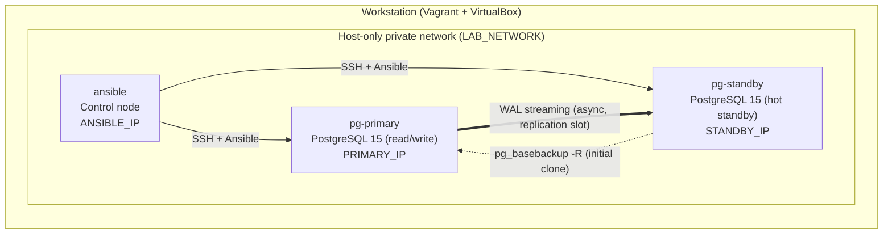

# PostgreSQL 15 Streaming Replication with Ansible


Automated, validated setup of a PostgreSQL 15 **primary → standby** physical streaming replication pair, driven by an Ansible control node. The environment runs on three Vagrant/VirtualBox VMs.

---

## Table of Contents

1. [Project Overview](#project-overview)
2. [Architecture](#architecture)
3. [Components](#components)
4. [Project Structure](#project-structure)
5. [Features](#features)
6. [Prerequisites](#prerequisites)
7. [Configuration Details](#configuration-details)
8. [Deployment and Automation Steps](#deployment-and-automation-steps)
9. [Verification](#verification)
10. [Troubleshooting and Known Issues](#troubleshooting-and-known-issues)
11. [Security Considerations](#security-considerations)
12. [Cleanup](#cleanup)
13. [Learning Objectives](#learning-objectives)
14. [Next Targets](#next-targets)

---

## Project Overview

Building replication by hand is easy once. Building it **repeatably** is the goal of this project.

The whole setup is treated as code:

- An **Ansible inventory** that describes the topology by role (`primary`, `standby`).
- A **staged playbook** (`site.yml`) that validates the environment, prepares the primary, builds the standby from a base backup and proves that data flows end to end.
- **Vagrant** to create the three-VM environment on a private network.

> **Status:** the standby runs in recovery and streams WAL from the primary. This is a learning and lab project. It has **no automatic failover** (see [Next Targets](#next-targets)).

---

## Architecture



**Data flow**

1. Ansible prepares the primary (replication role, slot, parameters, `pg_hba.conf`).
2. The standby is cloned with `pg_basebackup -R`, which also writes `standby.signal` and the connection settings.
3. The standby starts in recovery and the WAL receiver streams changes from the primary through a physical replication slot.

---

## Components

| Component | Role | Details |
|---|---|---|
| `pg-primary` | Primary database | PostgreSQL 15, accepts reads and writes |
| `pg-standby` | Physical standby | PostgreSQL 15, hot standby (read-only queries) |
| `ansible` | Control node | Ansible 2.9, SSH key authentication to both database nodes |
| Vagrant | VM provisioning | Box `centos/7`, version `2004.01` |
| VirtualBox | Hypervisor | Host-only private network |
| Replication slot | WAL retention | `standby1_slot`, keeps WAL until the standby has read it |

---

## Project Structure

```text
postgres-replication-ansible/
├── README.md
├── Vagrantfile                # 3 VMs, private network, SSH key + /etc/hosts bootstrap
├── .gitignore
├── keys/                      # generated locally, NEVER committed
│   ├── <KEY_NAME>
│   └── <KEY_NAME>.pub
└── ansible/
    ├── ansible.cfg            # inventory, SSH user/key, privilege escalation
    ├── inventory.ini          # groups: primary, standby, pg (parent) + shared vars
    └── site.yml               # staged playbook (Stage 0 to Stage 3)
```

Suggested `.gitignore`:

```gitignore
keys/
.vagrant/
logs/
*.log
*.pem
```

---

## Features

1. **Role-based inventory**: hosts grouped as `primary` and `standby` under a parent group `pg`; shared variables live in one place.
2. **Pre-validation (Stage 0)**: disk space, name resolution, primary health, server major version, `pg_hba.conf` presence.
3. **Safety guard**: a standby data directory is never wiped unless `force_rebuild=true` is passed explicitly.
4. **Primary preparation (Stage 1)**: replication role, physical replication slot, WAL and connection parameters, network-restricted `pg_hba.conf` entry, restart only when needed.
5. **Install check and standby build (Stage 2)**: installs PostgreSQL 15 only if it is missing, then `pg_basebackup -R`.
6. **Post-validation after every stage**: `assert` tasks with explicit success and failure messages.
7. **End-to-end proof (Stage 3)**: streaming client and active slot on the primary, replay lag check, test row written on the primary and read on the standby.
8. **Idempotent design**: safe to re-run; an existing standby (`standby.signal`) is not rebuilt.
9. **Run logging**: `ANSIBLE_LOG_PATH` for an audit trail.

### Playbook stages

| Stage | Target | Purpose | Gate |
|---|---|---|---|
| 0A | all nodes | Disk space, hostname resolution | `✔ PRE-CHECK OK` |
| 0B | primary | Service active, not in recovery, version 15 | `✔ PRE-CHECK OK (primary)` |
| 0C | standby | Primary reachable, data-dir wipe safety guard | `✔ PRE-CHECK OK (standby)` |
| 1 | primary | Role, slot, parameters, `pg_hba.conf`, restart if needed | `✔ STAGE 1 COMPLETE` |
| 2 | standby | Verify or install PG 15, `pg_basebackup -R`, start, recovery check | `✔ STAGE 2 COMPLETE` |
| 3A | primary | Streaming client, slot active, lag, write test row | `✔ STAGE 3A COMPLETE` |
| 3B | standby | Read the replicated test row | `✔ STAGE 3B COMPLETE` |

---

## Prerequisites

**Host machine**

- [VirtualBox](https://www.virtualbox.org/) and [Vagrant](https://www.vagrantup.com/)
- Git Bash, or any shell with `ssh-keygen`
- About 3 GB of free RAM and 20 GB of free disk space for the three VMs

**Database state (important)**

- The playbook **does not install or initialise the primary**. `pg-primary` must already have **PostgreSQL 15 installed, initialised and running**.
- Data directory is assumed to be `/var/lib/pgsql/15/data` (PGDG layout).
- The standby needs internet access to the PostgreSQL and EPEL repositories (archive mirrors, see below).

> **Note on CentOS 7:** it is end-of-life. The VM bootstrap points yum to `vault.centos.org`, and EPEL to `archives.fedoraproject.org`. PGDG repositories other than `pgdg15` and `pgdg-common` return `410 Gone` and must stay disabled.

---

## Configuration Details

### Network and resources

| VM | Hostname | IP | CPU | RAM |
|---|---|---|---|---|
| Primary | `pg-primary` | `<PRIMARY_IP>` | 1 | 1024 MB |
| Standby | `pg-standby` | `<STANDBY_IP>` | 1 | 1024 MB |
| Control node | `ansible` | `<ANSIBLE_IP>` | 1 | 1024 MB |

Base box: `centos/7`, version `2004.01`.

**Placeholders used in this README**

Real addresses and key names are intentionally not published. Replace the placeholders with your own values.

| Placeholder | Meaning |
|---|---|
| `<PRIMARY_IP>` / `<STANDBY_IP>` / `<ANSIBLE_IP>` | Host-only IPs you assign to the three VMs in the Vagrantfile |
| `<LAB_NETWORK_CIDR>` | The host-only network containing those IPs, in CIDR form |
| `<KEY_NAME>` | File name of the lab SSH key pair generated in `keys/` |
| `<LAB_KEY>` | Name under which the private key is stored on the control node (`~/.ssh/`) |
| `CHANGE_ME` | Replication password (use Ansible Vault) |

Use the same IPs in the Vagrantfile, `inventory.ini` and `/etc/hosts` bootstrap.

### Inventory variables (`ansible/inventory.ini`)

```ini
[primary]
pg-primary ansible_host=<PRIMARY_IP>

[standby]
pg-standby ansible_host=<STANDBY_IP>

[pg:children]
primary
standby

[pg:vars]
pgdata=/var/lib/pgsql/15/data
repl_user=replicator
repl_pass=CHANGE_ME
slot=standby1_slot
primary_ip=<PRIMARY_IP>
lab_net=<LAB_NETWORK_CIDR>
```

> Replace `CHANGE_ME` with your own password. For anything beyond a throwaway lab, store it with `ansible-vault` (see [Security Considerations](#security-considerations)).

### PostgreSQL parameters set on the primary

| Parameter | Value | Why |
|---|---|---|
| `listen_addresses` | `*` | Accept connections from the standby |
| `max_wal_senders` | `10` | Allow WAL sender processes |
| `max_replication_slots` | `10` | Allow physical replication slots |
| `hot_standby` | `on` | Allow read-only queries on the standby |
| `wal_keep_size` | `256MB` | Extra WAL retention buffer |

### `pg_hba.conf` entry added on the primary

```text
host replication replicator <LAB_NETWORK_CIDR> md5
```

### Ansible settings (`ansible/ansible.cfg`)

```ini
[defaults]
inventory = inventory.ini
host_key_checking = False
remote_user = vagrant
private_key_file = /home/vagrant/.ssh/<LAB_KEY>
retry_files_enabled = False
allow_world_readable_tmpfiles = True

[privilege_escalation]
become = True

[ssh_connection]
pipelining = True
```

---

## Deployment and Automation Steps

### 1. Clone and generate the lab SSH key (host)

```bash
git clone https://github.com/<your-username>/postgres-replication-ansible.git
cd postgres-replication-ansible
mkdir -p keys
ssh-keygen -t rsa -b 2048 -m PEM -N "" -f keys/<KEY_NAME>
```

The key pair is generated locally and ignored by Git. The Vagrantfile reads it and installs the public key on every VM.

### 2. Start the VMs (host)

```bash
vagrant up pg-standby ansible
vagrant status
```

Start the primary first if it is stopped (`vagrant up default` for an existing primary, or `vagrant up pg-primary` for a fresh one). The Vagrantfile in this repo defines the primary under the machine name used by the original environment; adjust the `config.vm.define` name if you build the primary from scratch.

### 3. Check connectivity (control node)

```bash
vagrant ssh ansible
ping -c2 pg-primary
ping -c2 pg-standby
ansible pg -m ping
```

Both database nodes must return `pong`.

### 4. Run the playbook (control node)

```bash
mkdir -p ~/logs
ansible-playbook site.yml --syntax-check
ANSIBLE_LOG_PATH=~/logs/site_$(date +%F_%H%M%S).log ansible-playbook site.yml
```

Keep `ANSIBLE_LOG_PATH=...` on the **same line** as the command, otherwise the variable does not reach Ansible.

Expected output ends with:

```text
✔ STAGE 1 COMPLETE ...
✔ STAGE 2 COMPLETE ...
✔ STAGE 3A COMPLETE ...
✔ STAGE 3B COMPLETE ...
✔✔ ALL STAGES PASSED: pg-primary -> pg-standby streaming replication working
```

### 5. Summarise the log (control node)

```bash
grep -n "fatal\|COMPLETE\|PASSED" ~/logs/site_*.log | tail -10
```

### Rebuilding an existing standby

By design the playbook refuses to wipe a standby that already has a non-standby cluster. To rebuild on purpose:

```bash
ansible-playbook site.yml -e force_rebuild=true
```

---

## Verification

**On the primary**

```bash
sudo -u postgres psql -c "select application_name, client_addr, state, sync_state from pg_stat_replication;"
sudo -u postgres psql -c "select slot_name, active from pg_replication_slots;"
```

Expected: one row with `state = streaming`, and the slot `active = t`.

**On the standby**

```bash
sudo -u postgres psql -tAc "select pg_is_in_recovery();"     # t
sudo -u postgres psql -tAc "select status from pg_stat_wal_receiver;"   # streaming
```

**Replay lag (on the primary)**

```bash
sudo -u postgres psql -c "select pg_wal_lsn_diff(pg_current_wal_lsn(), replay_lsn) as lag_bytes from pg_stat_replication;"
```

**Manual data test**

```bash
# primary
sudo -u postgres psql -c "create table if not exists public.manual_test(id int); insert into public.manual_test values (1),(2),(3);"
# standby
sudo -u postgres psql -c "select * from public.manual_test;"
```

---

## Troubleshooting and Known Issues

| Symptom | Cause | Fix |
|---|---|---|
| `410 Gone` from `pgdgNN` repo during install | The PGDG repo RPM enables old repositories whose URLs are gone | Keep only `pgdg15` and `pgdg-common` enabled |
| `libzstd >= 1.4.0` dependency error | CentOS 7 ships an older `libzstd` | Install `epel-release`, point EPEL to the archive mirror, install `libzstd` |
| EPEL or CentOS repo timeouts | End-of-life mirrors | Use `vault.centos.org` and `archives.fedoraproject.org` |
| `pg_basebackup: could not create directory "/u01": Permission denied` | The primary uses custom tablespaces whose paths do not exist on the standby | Create the same directories on the standby (`owner postgres`, mode `0700`, empty) before the base backup |
| Standby fails to start: `requested recovery stop point is before consistent recovery point` | A base backup also copies the primary's `postgresql.conf`; a leftover `recovery_target_lsn` stops recovery too early | Comment out `recovery_target*` in the standby's `postgresql.conf` (and `restore_command` if it points to a missing archive path) |
| `cp: cannot stat '/arch/...'` in the standby log | `restore_command` copied from the primary | Comment it out on the standby; replication does not need it |
| YAML error when editing `site.yml` in `vi` | Paste mangled the first line | Use `:set paste` first, or write the file with `cat > file <<'EOF'` |
| `FirewallD is not running` | Informational; the task is set to ignore errors | None needed on this lab |
| Log file not created | `ANSIBLE_LOG_PATH` set on a separate line | Put it on the same line as `ansible-playbook` |

> **Current limitation:** the tablespace directory creation and the `recovery_target*` / `restore_command` cleanup are **manual steps** and are not part of `site.yml`. They are only needed when the primary has custom tablespaces or inherited recovery settings. Automating them is on the roadmap.

---

## Security Considerations

- **Never commit** `keys/`, `.vagrant/`, logs or real passwords. `pg_basebackup` command lines can expose the replication password in logs, so treat log files as sensitive.
- Store the replication password with Ansible Vault:

  ```bash
  ansible-vault create group_vars/all/vault.yml     # vault_repl_pass: <password>
  ```

  and reference it in the inventory as `repl_pass={{ vault_repl_pass }}`.
- The SSH key in `keys/` is a **lab key**. Do not reuse it elsewhere.
- `pg_hba.conf` restricts replication to `<LAB_NETWORK_CIDR>`. Narrow it to the standby's single address for tighter control.
- Use `scram-sha-256` instead of `md5` and enable TLS for anything beyond a lab.
- `host_key_checking = False` is convenient for disposable VMs; enable it for real environments.

---

## Cleanup

**Stop the VMs (keep data)**

```bash
vagrant halt
```

**Drop the replication slot first if the standby will be removed or stays down for long.** An unused slot keeps WAL on the primary and can fill its disk.

```bash
sudo -u postgres psql -c "select pg_drop_replication_slot('standby1_slot');"
```

**Remove only the new VMs (the primary is untouched)**

```bash
vagrant destroy pg-standby ansible -f
```

**Remove everything created by this project**

```bash
vagrant destroy -f      # also deletes the primary VM and its data
rm -rf .vagrant keys logs
```

> `vagrant destroy` without a machine name removes **all** VMs, including the primary. Name the machines explicitly if you want to keep it.

---

## Learning Objectives

- Understand PostgreSQL **physical streaming replication**: WAL, replication slots, `standby.signal`, hot standby.
- Design an **Ansible inventory** with groups, parent groups and shared variables.
- Write **idempotent** playbooks with `when`, `block`, `register`, `assert` and `delegate`-free role targeting.
- Apply **pre-validation and post-validation** gates so automation fails fast with clear messages.
- Diagnose real-world issues: end-of-life repositories, missing dependencies, tablespaces under `pg_basebackup`, inherited recovery settings.
- Use **Vagrant** for repeatable multi-VM environments and key-based SSH bootstrap.
- Practise **safe operations**: guards against wiping data, replication-slot hygiene, log handling.

---

## Next Targets

- [ ] Automate tablespace directory creation and standby config cleanup inside `site.yml`
- [ ] Controlled **switchover** and **failover** tests (`pg_promote`, rebuild the old primary as a standby with `pg_rewind`)
- [ ] Automatic failover with **Patroni** (etcd) or **repmgr**
- [ ] **Synchronous replication** (`synchronous_standby_names`) and lag-based alerts
- [ ] Monitoring with `postgres_exporter`, Prometheus and Grafana
- [ ] Backups and PITR with **pgBackRest** or Barman
- [ ] Move secrets to **Ansible Vault**; switch to `scram-sha-256` and TLS
- [ ] Refactor `site.yml` into **roles** (`postgres_primary`, `postgres_standby`, `common`)
- [ ] Add **molecule** or CI linting (`ansible-lint`, `yamllint`)
- [ ] Upgrade the base image to a supported OS (Rocky Linux or AlmaLinux 9)

---

## License

MIT. Add a `LICENSE` file before publishing.

## Author

**Vijay**, Oracle and PostgreSQL DBA

